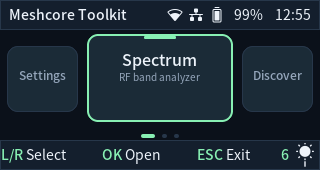
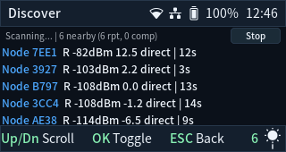
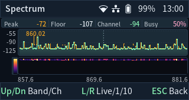
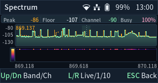
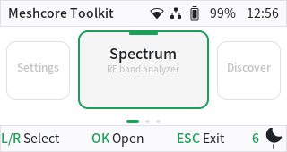

# Meshcore Toolkit for CardputerZero

A LoRa mesh health analyzer for the M5Stack CardputerZero (aarch64 Linux,
320×170). It configures your MeshCore radio, verifies the Cap LoRa-1262 at
startup, discovers nearby MeshCore nodes, and sweeps the band around your
channel to show what the radio is hearing. It opens directly on **Spectrum**.

`ESC` returns to the sliding card carousel, ordered **Spectrum, Discover,
Settings** — Settings is always the last card. The center card is flanked by side
cards and a dot indicator.

| Main menu | Discover | Spectrum (band) | Spectrum (channel) |
| --- | --- | --- | --- |
|  |  |  |  |

The light theme is one keypress away, and the `6` chip in the bottom bar shows
which key does it:



*Captured on the device with the app's own screenshot key (320×170).*
*The app starts dark; `6` switches to a light theme.*

## Features

- **Sliding menu** — a three-card carousel ordered Spectrum, Discover, Settings;
  Z/C move the selection, OK opens it. Settings stays last.
- **Dark by default** — a deep navy canvas with panel and card tiers and a mint
  accent; `6` toggles a light theme.
- **Spectrum** — a 160-bin swept-RSSI analyzer centred on the configured
  channel (24 MHz span, 62.5 kHz resolution bandwidth). A compact single row
  shows Peak, Floor, Channel and Busy; the larger plot has a peak-hold trace and
  your channel band, and the taller waterfall keeps a colour history. Up/Down
  switch between Band and Channel views, Left/Right cycle Live / 1 min / 10 min
  waterfall history, and `ESC` leaves the screen. The theme toggle is omitted on
  this screen.
- **Discover** — sends a zero-hop MeshCore `NODE_DISCOVER_REQ` sweep and lists
  every node that answers, strongest first. The header shows how many are
  nearby and how many are repeaters/companions. `OK` pauses and resumes the
  sweep; Up/Down scroll the list; `ESC` stops scanning and leaves the screen.
  Node names are filled in from ADVERT packets heard while listening.
- **Settings** — configure every primary MeshCore radio option: node name,
  region (with presets), frequency, spreading factor, bandwidth, coding rate,
  TX power, sync word, and preamble. Up/Down pick a field, OK opens it,
  Left/Right change the value, OK saves and ESC cancels.
- **Typing** — the node name is entered directly on the CardputerZero keyboard;
  the same letters act as arrows everywhere else, and the app switches behaviour
  per mode so `Z`/`C`/`F`/`X` type normally while the editor is open.
- **Regions** — Europe, USA/Canada, Australia, New Zealand, EU 433, and a Custom
  mode for manual frequency plans.
- **Radio bring-up** — powers the hat's EXT 5V rail, drives the SX1262 RESET,
  BUSY and DIO1 lines through the Linux GPIO character device, and enables the
  Cap LoRa-1262 antenna switch through P0 of its PI4IOE5V6408 expander. The
  startup check still reports a missing/unpowered hat on the error screen.

## Requirements

| | |
| --- | --- |
| Device | M5Stack CardputerZero (C154/C155), 320×170 panel |
| LoRa | M5Stack Cap LoRa-1262 (SX1262, SPI) |
| OS packages | `libfreetype6`, `libpng16-16`, `libjpeg62-turbo`, `zlib1g`, `libfmt10` |

## Controls

The arrow keys sit under `FN` on the CardputerZero keyboard, so the app uses
plain letters instead — no `FN` chord is ever needed.

| Key | Action |
| --- | --- |
| `←` / `→` (or `Z` / `C`) | move the carousel selection / change a value while editing |
| `↑` / `↓` (or `F` / `X`) | choose a settings field / cycle a name character / scroll Discover |
| `OK` / `Enter` | open the selected card, start editing, or pause/resume Discover |
| any letter / digit / space / `-` `.` | type into the node name while it is being edited |
| `ESC` | cancel an edit, leave a screen, or exit from the main screen |
| `6` | light / dark theme (not available on Spectrum) |
| `PRSC` | save a screenshot |
| `HELP` | keyboard help overlay |

**Discover:** `↑`/`↓` (or `F`/`X`) scroll the node list; `OK` stops the sweep
("Scan" button) and `OK` again continues it ("Stop" button); `ESC` stops the
sweep before returning to the menu.

**Spectrum:** `↑`/`↓` (or `F`/`X`) switch Band / Channel; `←`/`→` (or `Z`/`C`)
cycle Live / 1 min / 10 min; `ESC` returns to the menu.

## Regions

Selecting a region applies a preset for frequency, spreading factor, bandwidth,
coding rate, sync word, and MeshCore's SF-dependent preamble:

| Region | Frequency | SF | Bandwidth | CR | Preamble |
| --- | --- | --- | --- | --- | --- |
| Europe | 869.618 MHz | 8 | 62.5 kHz | 4/8 | 32 |
| USA / Canada | 910.525 MHz | 7 | 62.5 kHz | 4/5 | 32 |
| Australia | 915.800 MHz | 10 | 250 kHz | 4/5 | 16 |
| New Zealand | 917.375 MHz | 11 | 250 kHz | 4/5 | 16 |
| EU 433 | 433.650 MHz | 11 | 250 kHz | 4/5 | 16 |
| Custom | manual | manual | manual | manual | manual |

Presets are starting points, not legal advice — confirm the plan is permitted in
your region before transmitting. Editing a radio field switches the region to
**Custom** so your manual values are kept.

MeshCore itself fixes the LoRa sync word at `0x12` and uses 32 preamble symbols
for SF ≤ 8, 16 above. Keep those values if you want stock MeshCore nodes to hear
the toolkit.

## Configuration

Settings are saved to `meshcore-toolkit.conf`:

- desktop: `config/meshcore-toolkit.conf` in the repository;
- device: `/etc/meshcore-toolkit.conf`, with a per-user override written to
  `~/.config/meshcore-toolkit/meshcore-toolkit.conf`. Existing first-release
  configs are migrated on load (0x2B sync -> 0x12, 16 -> 32 preamble for SF <= 8,
  Europe CR 4/5 -> 4/8) and rewritten on exit.

```ini
[application]
dark_mode=yes

[mesh]
node_name=MeshToolkit
region=europe
freq=869618000
sf=8
bw_index=6        # 0=7.8 kHz ... 9=500 kHz
cr=8              # 5..8 -> 4/5 .. 4/8 (EU/UK Narrow uses 4/8)
power=22
sync=18           # 0x12, MeshCore's private sync word
preamble=32       # MeshCore uses 32 for SF<=8, 16 above
```

## Build

### Desktop simulator

```bash
sudo apt install -y build-essential cmake ninja-build libpng-dev libjpeg-dev \
  libfmt-dev libsdl2-dev libfreetype-dev zlib1g-dev
cmake --preset linux-x86-64
cmake --build --preset linux-x86-64-dbg
./build/linux-x86-64/Debug/meshcore-toolkit
```

The desktop simulator renders the 320×170 screen with a virtual keypad. The
LoRa path is **simulated**: Discover shows a labelled `SIM` neighbourhood and
Spectrum generates synthetic bins, so the screens can be exercised without a
hat. No hardware is touched.

### CardputerZero package (cross build)

```bash
sudo apt install crossbuild-essential-arm64
cmake --workflow --preset cp0-cross-package
```

This produces `dist/Meshcore Toolkit_0.2.1_rev1_arm64.deb`. Device builds fetch
RadioLib (MIT) at configure time and statically link only the SX1262 subset;
there is no new runtime package dependency. The `cp0-cross` configure step
needs network access the first time for LVGL, RadioLib, and the BSP sysroot.

## Install on the device

```bash
REMOTE_USER=wasp REMOTE_HOST=100.101.102.67 ./deploy.sh
ssh wasp@100.101.102.67 'sudo apt install --no-install-recommends ./Meshcore*_arm64.deb'
```

The package installs the binary to `/usr/bin/meshcore-toolkit`, assets under
`/usr/share/meshcore-toolkit/`, the APPLaunch entry, and the system default
config at `/etc/meshcore-toolkit.conf`.

## Status and limitations

- **Discover and Spectrum are verified on hardware.** On the test device the
  Spectrum plot, waterfall and all four tiles responded to a real SX1262 sweep
  (RX), and Discover sent a zero-hop request and received `NODE_DISCOVER_RESP`
  replies from local repeaters (RSSI around -82 to -107 dBm). Repeaters
  rate-limit discovery requests (four per two minutes) and may delay their
  replies by tens of seconds, so the list can take a sweep or two to populate.
- **The hat is powered from the EXT 5V rail, which is off by default.** With the
  rail down the SX1262 answers nothing over SPI — every read returns `0x00`,
  which looks exactly like a missing hat. The probe sets
  `/sys/class/leds/ext_5v_out/brightness` to `1`, waits 150 ms for the rail to
  settle, and only then reads the SX1262 `GetStatus` byte. Verified on hardware:
  hat detected on `/dev/spidev0.1`.
- **The rail node is `root:gpio` mode `0664`**, so the app needs `gpio` group
  membership to power the hat. The radio path also needs read/write access to
  `/dev/gpiochip0`, `/dev/spidev0.1`, and `/dev/i2c-1`; the development unit
  grants the `gpio`, `spi`, and `i2c` groups to the login user.
- **PI4IO RF switch.** The Cap LoRa-1262 puts its antenna switch on P0 of a
  PI4IOE5V6408 at I2C address `0x43`. The toolkit snapshots the expander
  registers, drives P0 high, and restores those bits on exit. A missing
  expander is reported but not fatal, so a Cap LoRa868 (no switch) can still be
  used.
- **Node names are display-only.** NODE_DISCOVER_RESP carries a public key, not
  a name; the list fills names from ADVERT packets heard while the screen is
  open. Those names are not signature-verified in this milestone; do not treat
  them as identity proof.
- **No Map, favourites, contact store, or wardriving yet.** Discover is the
  active list and Spectrum is the RF view; the Map button from the reference UI
  is intentionally omitted until there is a map backend.
- **MeshCore protocol subset.** The on-air code implements zero-hop
  `NODE_DISCOVER_REQ`/`NODE_DISCOVER_RESP` and passive ADVERT parsing; it does
  not route, chat, or join a mesh. It is a diagnostic listener, not a MeshCore
  node.

## License

MIT — see [LICENSE](LICENSE).
