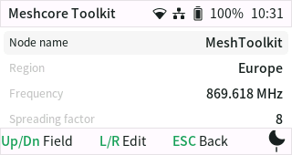

# Meshcore Toolkit for CardputerZero

A LoRa mesh health analyzer for the M5Stack CardputerZero (aarch64 Linux,
320×170). It configures your MeshCore node and radio, verifies the LoRa hat at
startup, and will analyze the health of nearby mesh nodes.

The main screen is a sliding card carousel — Settings, Test 1, Test 2 — ported
from the [CardputerZero mouse emulator](https://github.com/CardputerZero/cardputer-zero-mouse-emu)
layout, so the two apps look like siblings on the device.

| Main menu | Settings |
| --- | --- |
|  |  |

*Captured on the device (320×170 framebuffer dump).*

## Features

- **Sliding menu** — a three-card carousel with a dot indicator; Z/C move the
  selection, OK opens it.
- **Settings** — configure every primary MeshCore radio option:
  node name, region (with presets), frequency, spreading factor, bandwidth,
  coding rate, TX power, sync word, and preamble.
- **Regions** — Europe, USA/Canada, Australia, New Zealand, EU 433, and a Custom
  mode for manual frequency plans.
- **LoRa hat check** — probes the SX1262 hat on the SPI bus at startup and shows
  an error screen if it is not responding.

## Requirements

| | |
| --- | --- |
| Device | M5Stack CardputerZero (C154/C155), 320×170 panel |
| LoRa | M5Stack Cap LoRa-1262 (SX1262, SPI) |
| OS packages | `libfreetype6`, `libpng16-16`, `libjpeg62-turbo`, `zlib1g`, `libfmt10` |

## Controls

| Key | Action |
| --- | --- |
| `Z` / `C` (or `←` / `→`) | move the carousel selection / edit a setting value |
| `OK` / `Enter` | open the selected card / edit the node name |
| `↑` / `↓` | choose a settings field / cycle a name character |
| `ESC` | back (or exit from the main screen) |
| `6` | light / dark theme |
| `PRSC` | save a screenshot |
| `HELP` | keyboard help overlay |

## Regions

Selecting a region applies a preset for frequency, spreading factor, bandwidth
and coding rate:

| Region | Frequency | SF | Bandwidth | CR |
| --- | --- | --- | --- | --- |
| Europe | 869.618 MHz | 8 | 62.5 kHz | 4/5 |
| USA / Canada | 910.525 MHz | 7 | 62.5 kHz | 4/5 |
| Australia | 915.800 MHz | 10 | 250 kHz | 4/5 |
| New Zealand | 917.375 MHz | 11 | 250 kHz | 4/5 |
| EU 433 | 433.650 MHz | 11 | 250 kHz | 4/5 |
| Custom | manual | manual | manual | manual |

Presets are starting points, not legal advice — confirm the plan is permitted in
your region before transmitting. Editing a radio field switches the region to
**Custom** so your manual values are kept.

## Configuration

Settings are saved to `meshcore-toolkit.conf`:

- desktop: `config/meshcore-toolkit.conf` in the repository;
- device: `/etc/meshcore-toolkit.conf`, with a per-user override written to
  `~/.config/meshcore-toolkit/meshcore-toolkit.conf`.

```ini
[application]
dark_mode=no

[mesh]
node_name=MeshToolkit
region=europe
freq=869618000
sf=8
bw_index=6        # 0=7.8 kHz ... 9=500 kHz
cr=5              # 5..8 -> 4/5 .. 4/8
power=22
sync=43           # 0x2B
preamble=16
```

## Build

### Desktop simulator

```bash
sudo apt install -y build-essential cmake ninja-build libpng-dev libjpeg-dev \
  libfmt-dev libsdl2-dev libfreetype-dev zlib1g-dev
cmake --preset linux-x86-64
cmake --build --preset linux-x86-64-dbg
./build/linux-x86-64/Debug/meshcore-toolkit
```

The desktop simulator renders the 320×170 screen with a virtual keypad; the LoRa
probe is **simulated** (always reports working).

### CardputerZero package (cross build)

```bash
sudo apt install crossbuild-essential-arm64
cmake --workflow --preset cp0-cross-package
```

This produces `dist/Meshcore Toolkit_0.2.1_rev1_arm64.deb`.

## Install on the device

```bash
REMOTE_USER=wasp REMOTE_HOST=100.101.102.67 ./deploy.sh
ssh wasp@100.101.102.67 'sudo apt install --no-install-recommends ./Meshcore*_arm64.deb'
```

The package installs the binary to `/usr/bin/meshcore-toolkit`, assets under
`/usr/share/meshcore-toolkit/`, the APPLaunch entry, and the system default
config at `/etc/meshcore-toolkit.conf`.

## Status and limitations

- **First version.** The sliding menu, Settings editor (all primary MeshCore
  options), region presets, LoRa-hat startup check, icon, and packaging are in
  place; Test 1 / Test 2 are placeholders for the mesh-health views.
- **LoRa probe is best-effort.** It enumerates `/dev/spidev*` and reads the
  SX1262 `GetStatus` byte (`0x00` means nothing is driving MISO).
- **The hat is more than a bare SPI device.** M5Stack's own
  `/usr/share/Cap-LoRa-1262/bin/Cap-LoRa-1262` drives RESET/BUSY through a
  `PI4IOE5V6408` I²C expander (falling back to direct GPIO). Reading `GetStatus`
  without that bring-up sequence can fail even with the hat seated, so the next
  step is to implement the expander/GPIO sequence instead of relying on the raw
  read.
- **On the development unit** no expander answered on any I²C bus and
  `/dev/spidev0.1` read `0x00`, so the app currently lands on the "LoRa hat not
  working" screen; `ESC` continues into the UI in degraded mode (`OK` retries).
- **MeshCore integration is config-first.** The radio settings mirror MeshCore's
  `lora` namespace and NodePrefs; the on-air protocol/routing driver is the next
  milestone.

## Credits

- UI carousel language and layout metrics: [Ultimate-Remote](https://github.com/geo-tp/Ultimate-Remote) (MIT)
- Main-screen layout: [cardputer-zero-mouse-emu](https://github.com/CardputerZero/cardputer-zero-mouse-emu)
- Radio configuration model: [MeshCore](https://github.com/meshcore-dev/MeshCore) (MIT)
- LoRa hat: [M5Stack Cap LoRa-1262](https://docs.m5stack.com/en/cap/Cap_LoRa-1262)

## License

MIT — see [LICENSE](LICENSE).
